# Architecture: a Haiku-stable 7x24 loop

Status: canonical target architecture, 2026-11-20. It describes what exists on `main`, what is a library that nothing calls yet, and what is missing. It does not claim that the production cutover is done. Work items are tracked under the parent issue #374 [RT-B] (see [Work items](#work-items)). The layer that lets this loop run without the external assistant is designed in [Self-supervision](self-supervision.md) (#414 [RT-S]).

## Why this redesign

The owner wants one set of constraints under which even a weak model (all roles currently run on a Haiku-class model, see [17 Model Routing](17-model-routing.md)) runs a stable 7x24 workflow with four capabilities:

| Capability | Observable criterion |
| --- | --- |
| Wish-style programming | A large request is decomposed into sized children and queued with dependencies, with no human split. |
| Self-loop | An issue labelled `rt:go` is claimed, executed, reviewed, merged and closed with no human step. |
| Unsupervised | Routine decisions (in the autonomous scope below) are taken by the loop; owner pull-backs per merged PR fall (measured by #337). |
| Self-iteration | A classified real failure produces a recovery action or a fix issue, not a hand patch on the host. |

### Root cause

The five always-on primitives already exist as tested libraries under `runtime/lib/`:

- `event-inbox.mjs` (durable inbox, de-dup by `source_event_id`), `event-claim.mjs` (claims, `processPending`, `coalesce`), `event-timers.mjs` (due timers, `waitRelease`);
- `outbox.mjs` (durable outbox, `dispatch`, `decideTurn`);
- `role-memory.mjs` and `reflect.mjs` (layered memory);
- `decision-cards.mjs` (suspend one line, resume from an inbox event);
- `gh-write-proxy.mjs` (credential-isolating write proxy, wired only into `bin/rt-chief.mjs`);
- and, since #333 and #312, `liveness.mjs` (bounded wait, freeze classification, adaptive cap) and `merge-order.mjs` (dependency-ordered merges).

`runtime/rtd.mjs --loop` runs the daemon cycle (#377) and consumes most of them: due timers, the inbox, the outbox, role memory, decision cards and the liveness cap. `deploy/systemd/rtd.service` is an uninstalled template that runs `rtd.mjs --loop` without `--live`, so it runs in shadow mode. The production loop is still the host scripts `host/rt-sched.py` and `host/rt-work.sh`: a 300 s GitHub issue poll with several workers. Each host cycle fires due timers into the inbox (`host/bin/rt-timers.mjs`, #575), a worker's `wait` decision writes a due timer and frees its slot (`wait_release` in `host/rt-work.sh`, #577), and `resume_waits` in `host/rt-sched.py` requeues a waiting issue when an unacked inbox event routes to it. Porting the rest of the inbox into the host loop is still open (#569). The host sends its comments, labels and merges through the durable outbox (`host/outbox-bridge.mjs`, #578, #579). #290 / PR #321 delivered the cutover switch (shadow by default, config-only `--live`), not a cutover. Closing the remaining gap to a cutover is the point of this document.

## System diagram

Legend: green = implemented and on the live path; yellow = partial; blue = library with tests, not wired into the daemon or the host loop; red = missing.

```mermaid
flowchart LR
  classDef impl fill:#d4f7d4,stroke:#2b8a3e,color:#111
  classDef partial fill:#fff3bf,stroke:#e67700,color:#111
  classDef lib fill:#d0ebff,stroke:#1864ab,color:#111
  classDef missing fill:#ffe3e3,stroke:#c92a2a,color:#111

  subgraph INTAKE["1 Intake"]
    REQ["Requirements: front Chief, intake-backlog (implemented)"]:::impl
    FB["Feedback plugins: GitHub issues adapter only; X and Discord missing (#207, #366, #369; partial)"]:::partial
    WH["Webhook listener: loopback, not started by default (#383; library-only)"]:::lib
    DEC["Decision chain: decide, machine (implemented)"]:::impl
    HUM["Human intervention: /rt commands, owner comments (implemented)"]:::impl
  end

  INBOX["2 Event inbox: event-inbox, event-claim (implemented in the daemon cycle)"]:::impl
  TIMERS["Due timers: event-timers, fired in the daemon cycle (implemented)"]:::impl
  WAKE["Wake signal: an inbox write ends the wait (implemented)"]:::impl

  subgraph PIPE["3 Single-task pipeline"]
    P1["Requirements design and goal (partial)"]:::partial
    P2["Technical plan gate before execute (optional, off by default)"]:::impl
    P3["Decomposition (implemented)"]:::impl
    P4["Execution: workers, worktree, harness (implemented)"]:::impl
    P5["Review: gates 0/1/2 (implemented)"]:::impl
    P6["e2e tests (optional, off by default)"]:::impl
    P7["Acceptance: accept, parent-close (implemented)"]:::impl
  end

  subgraph TIERS["4 Completion tiers"]
    T1["auto-silent: tier function (partial)"]:::partial
    T2["auto-notify: default plan and action journal (partial)"]:::partial
    T3["approve-first: ask path and safety-file approval (partial)"]:::partial
  end

  subgraph APPROVAL["6 Human approval"]
    RT["Real-time: decision cards in the daemon cycle, no card provider (partial)"]:::partial
    DF["Deferred: action journal, /rt confirm, amend, rollback (partial)"]:::partial
  end

  OUTBOX["5 Outbox and dispatcher, dispatched in the daemon cycle (implemented)"]:::impl
  IM["IM adapters: outbox-im (library-only)"]:::lib
  GHW["GitHub writes: gh shim on host, gh-write-proxy (partial)"]:::partial

  subgraph SCHED["7 Concurrent queue, monitoring, dynamic scheduling"]
    Q["Workers, touch-set, series, deps, adaptive cap (partial: freezes not excluded from stall checks)"]:::partial
    LV["Liveness: bounded wait, freeze ledger, adaptive cap (implemented in the daemon cycle)"]:::impl
    MON["Supervisor, stall, diagnose, usage ledger (partial)"]:::partial
    MEM["Role memory preload and reflect (partial: role prompts in rtd only)"]:::partial
  end

  REQ --> INBOX
  FB --> INBOX
  WH --> INBOX
  HUM --> INBOX
  DEC --> PIPE
  TIMERS --> INBOX
  INBOX --> WAKE --> Q
  Q --> P1 --> P2 --> P3 --> P4 --> P5 --> P6 --> P7
  P5 -- rework --> P4
  P6 -- rework --> P4
  P7 --> T1
  P7 --> T2
  P7 --> T3
  T3 --> RT
  T2 --> DF
  T1 --> OUTBOX
  T2 --> OUTBOX
  RT --> OUTBOX
  DF --> OUTBOX
  OUTBOX --> GHW
  OUTBOX --> IM
  RT -- owner reply event --> INBOX
  DF -- owner reply event --> INBOX
  MEM --- PIPE
  LV --- Q
  MON --- Q
```



The machine-readable status of each module (read by the Pages site follow-up) is:

<!-- rt:module-status -->
```json
[
  { "id": "intake-requirements", "name": "Intake: requirements", "status": "implemented", "code": ["runtime/lib/intake-backlog.mjs", "runtime/lib/front-chief.mjs", "bin/rt-chief.mjs"], "issues": [261, 263] },
  { "id": "intake-feedback", "name": "Intake: feedback plugins", "status": "partial", "code": ["runtime/lib/intake-sources.mjs", "runtime/lib/intake-adapters/github-issues.mjs", "runtime/intake-sources.config.json"], "issues": [207, 366, 369] },
  { "id": "intake-webhook", "name": "Intake: webhook listener", "status": "library-only", "code": ["runtime/lib/webhook-listener.mjs", "runtime/lib/intake-triggers.mjs"], "issues": [367, 383] },
  { "id": "intake-decision-chain", "name": "Intake: decision chain", "status": "implemented", "code": ["runtime/lib/decide.mjs", "runtime/lib/machine.mjs"], "issues": [29] },
  { "id": "intake-intervention", "name": "Intake: human intervention", "status": "implemented", "code": ["runtime/lib/rt-commands.mjs"], "issues": [267] },
  { "id": "inbox", "name": "Event inbox and claims", "status": "implemented", "code": ["runtime/lib/event-inbox.mjs", "runtime/lib/event-claim.mjs", "runtime/lib/daemon-loop.mjs"], "issues": [266, 268, 378, 384, 569] },
  { "id": "timers", "name": "Due timers", "status": "implemented", "code": ["runtime/lib/event-timers.mjs", "runtime/lib/daemon-loop.mjs", "host/rt-sched.py", "host/bin/rt-timers.mjs"], "issues": [269, 309, 384, 575, 577] },
  { "id": "pipeline-design", "name": "Pipeline: requirements design and goal", "status": "partial", "code": ["runtime/lib/intake-backlog.mjs"], "issues": [] },
  { "id": "pipeline-plan", "name": "Pipeline: technical plan", "status": "implemented", "code": ["runtime/lib/pipeline.mjs", "runtime/rtd.mjs", "runtime/plan-gate.config.json"], "issues": [382, 607] },
  { "id": "pipeline-decompose", "name": "Pipeline: decomposition", "status": "implemented", "code": ["runtime/lib/decisions.mjs", "runtime/lib/decompose-triggers.mjs"], "issues": [97, 331, 332] },
  { "id": "pipeline-execute", "name": "Pipeline: execution", "status": "implemented", "code": ["runtime/lib/workers.mjs", "runtime/lib/worktree.mjs", "runtime/lib/harness.mjs", "runtime/lib/agent-adapter.mjs"], "issues": [302, 303, 311] },
  { "id": "pipeline-review", "name": "Pipeline: review", "status": "implemented", "code": ["runtime/lib/gates.mjs", "runtime/lib/review-precondition.mjs", "runtime/lib/review-ledger.mjs"], "issues": [338, 341] },
  { "id": "pipeline-e2e", "name": "Pipeline: e2e tests", "status": "implemented", "code": ["runtime/lib/pipeline.mjs", "runtime/e2e.config.json"], "issues": [602] },
  { "id": "pipeline-accept", "name": "Pipeline: acceptance", "status": "implemented", "code": ["runtime/lib/accept.mjs", "runtime/lib/parent-close.mjs", "runtime/lib/aftercare.mjs"], "issues": [] },
  { "id": "merge-tiers", "name": "Completion tiers", "status": "partial", "code": ["runtime/lib/autonomy.mjs", "runtime/lib/merge.mjs", "runtime/lib/merge-risk.mjs", "runtime/lib/merge-decision.mjs", "runtime/lib/merge-order.mjs"], "issues": [273, 312, 380] },
  { "id": "outbox", "name": "Outbox and dispatcher", "status": "implemented", "code": ["runtime/lib/outbox.mjs", "runtime/lib/outbox-github.mjs", "runtime/lib/gh-write-proxy.mjs", "host/outbox-bridge.mjs"], "issues": [285, 286, 385, 570, 578] },
  { "id": "outbox-im", "name": "Outbox: IM adapters", "status": "library-only", "code": ["runtime/lib/outbox-im.mjs"], "issues": [381] },
  { "id": "approval-realtime", "name": "Approval: real-time", "status": "partial", "code": ["runtime/lib/decision-cards.mjs", "runtime/lib/daemon-cards.mjs", "runtime/lib/merge-decision.mjs"], "issues": [262, 387] },
  { "id": "approval-deferred", "name": "Approval: deferred, execute by default", "status": "partial", "code": ["runtime/lib/action-journal.mjs", "runtime/lib/action-replies.mjs", "runtime/lib/autonomy.mjs"], "issues": [389, 390, 579] },
  { "id": "scheduler", "name": "Concurrent queue and dynamic scheduling", "status": "partial", "code": ["runtime/lib/workers.mjs", "runtime/lib/touch-set.mjs", "runtime/lib/series-key.mjs", "runtime/lib/liveness.mjs"], "issues": [310, 333, 308, 309, 379] },
  { "id": "monitoring", "name": "Monitoring and justification", "status": "partial", "code": ["runtime/lib/stall.mjs", "runtime/lib/diagnose.mjs", "runtime/lib/usage-ledger.mjs", "runtime/supervise.mjs"], "issues": [218, 336, 337, 340] },
  { "id": "memory", "name": "Role memory", "status": "partial", "code": ["runtime/lib/role-memory.mjs", "runtime/lib/reflect.mjs", "runtime/lib/memory-store.mjs"], "issues": [265, 386] },
  { "id": "daemon", "name": "Daemon cycle loop", "status": "implemented", "code": ["runtime/lib/daemon-loop.mjs", "runtime/rtd.mjs", "runtime/supervisor/heartbeat.mjs"], "issues": [377] }
]
```

CI checks this catalog and the site on every pull request and on `main`: `npm run check:architecture-refs` (every code path exists in the tree and every issue number exists in the repository, see `scripts/check-architecture-refs.mjs`) and `npm run build:site -- --check` (`site/` equals a fresh build of this block). After editing the block, run `npm run build:site` and commit `site/`.

## The daemon cycle

`rtd.mjs --loop` (#377) runs this cycle until stopped; `runLoop` in `runtime/lib/daemon-loop.mjs` owns it. Before #377 the process ran one `runQueue` pass and exited. Each step is a call to an existing library function, or to a function this document names as an extension.

1. `runLoop` takes the cycle start from both clocks (`Date.now()` and `performance.now()`) and writes the heartbeat (`writeHeartbeat` in `runtime/supervisor/heartbeat.mjs`) with `daemon.state = 'running'` and `daemon.lastCycleAt` set to the cycle start. A throwing pass writes `stopped` and rethrows.
2. Classify the gap since the previous cycle: `recordCycleGap({ ledger, pollMs, start, end, wallDeltaMs, monoDeltaMs })` over a file-backed freeze ledger (`.roundtable/state/freeze-ledger.jsonl`). The ledger store is new; `liveness.mjs` takes it by injection.
3. Fire due timers: `openTimers(root).fire(Date.now())`. Each firing becomes one inbox event `timer:<id>:<at>`.
4. Produce inbox events from observations: `cycleSteps` calls `produceEvents` (`daemon-events.mjs`) on the GitHub reader. Owner comments, CI checks and new or updated issues become `owner_comment`, `ci` and `intake` events with stable `source_event_id`s (for example `gh-comment:<id>`, `gh-check:<suite id>:<conclusion>`, `gh-issue:<n>:<updated_at>`). Polling (`github-poll.mjs`, the `poll` option of `cycleSteps`) exists but `rtd.mjs` does not pass it yet, so polled sources are not read in the cycle. The webhook listener (`webhook-listener.mjs`, #383) would be a second producer of the same events; nothing starts it by default.
5. Drain the inbox: `processPending(root, dispatch)`. `rtd.mjs` passes `makeDispatchLine` as the dispatcher, after `applyActionReply` has applied any `/rt confirm`, `amend` or `rollback` to the action journal. A decision-card reply goes to `resumeFromApproval`, an ask is routed as a card, and anything else goes to the line's pipeline through the pass that follows. A line that throws is classified by the recovery table (`recover`, #388): a `wait` writes a due timer, any other class enqueues a `stall-alert`.
6. Schedule work: the pass runs `runQueue` with `workers` as a function, `() => Math.min(effectiveCap({ base, ledger, now, state }), governorCap)`, so the cap is evaluated on each pass. The resource governor can hold claims (`claimHold`) and stop new queue runs (`admit`) under host pressure; running work is not touched.
7. Flush side effects: `dispatch({ outbox, provider })` with the GitHub provider (`outbox-github.mjs`), after anomaly alerts are enqueued. No IM provider is passed yet: `outbox-im.mjs` is library-only (#381).
8. Wait: `wake.wait(pollMs)` when the wake signal exists, otherwise `boundedWait({ pollMs, sleep })`; both end early on shutdown. The whole cycle runs under a cycle deadline (`cycleDeadlineMs`, default 60 minutes; the pass is raced against it). When it is exceeded the heartbeat is written as `stopped`, the process prints `cycle deadline exceeded` and exits with code 77 (`EXIT_CYCLE_DEADLINE`) so the unit restarts it.

A write to the inbox raises the wake signal (`createWakeSignal`), so the next cycle starts within one tick instead of after the 300 s poll. Without a signal the poll still drains the inbox.

## Modules

### 1. Intake

**Responsibility.** Turn every input into a validated inbox event: requirements (front Chief conversation to issue), feedback (plugins), webhooks, the decision chain's own follow-ups, and human intervention.

**Interface.** Producers call `openInbox(root).accept({ source_event_id, kind, issue, payload, receivedAt })`. `kind` is one of `heartbeat`, `ci`, `owner_comment`, `intake`, `webhook` (`KINDS` in `event-inbox.mjs`). The front Chief already opens issues (`bin/rt-chief.mjs`, `intake-backlog.mjs`); The feedback adapters are #207 and its children #366 (adapter contract, poll runner feeding the inbox), #367 (signed webhook verification, `verifySignature` in `intake-triggers.mjs`), #368 and #369. The loopback HTTP listener that calls #367's verifier is `webhook-listener.mjs` (#383, child B8). External text never expands permissions: the payload is data, and the deep checks (prompt injection, scope) run inside the line, not in the handler.

**Status.** Requirements, decision chain and intervention are implemented. Feedback is partial: the adapter contract, the GitHub issues adapter and `runtime/intake-sources.config.json` exist (#366, #369), but the poll is not passed to the daemon cycle and there is no X or Discord adapter. The webhook verifier and listener are library-only: the listener binds to 127.0.0.1 unless told otherwise and nothing starts it by default (#367, #383).

### 2. Event inbox

**Responsibility.** The single source of truth for "something happened". Durable, de-duplicated, replayable, and the only path by which a line is woken or resumed.

**Interface (exists).** `openInbox(root)` returns `{ events(), accept(event) }`; `accept` returns `false` for a known `source_event_id`. `processPending(root, dispatch)` claims every event that is not acked, coalesces them, awaits `dispatch(batch)` and writes `applied` and `acked` markers. `coalesce(events)` groups by `kind` and `issue`.

**Interface (extension, child B2).** Each record gains `when` (`receivedAt`), `what` (a one-line summary derived from kind and payload), `session` (`issue:<n>`, `chat:<id>` or `none`) and an explicit status, appended as status records (`{ type: 'status', id, status, at }`) so the file stays append-only. `accept` of a known id appends a `dropped` record pointing at the original and still returns `false`. `coalesce` groups by `session`, so all events for one issue produce one run. A wake signal is raised after the durable write. **Interface (extension, child B2, #378).** `processPending` releases the unfinished claims when `dispatch` throws, so the events are dispatched again on the next call.

**State machine.**

```text
            accept (new id)                 claim                 dispatch resolves
 (none) ─────────────────────▶ pending ───────────────▶ claimed ─────────────────────▶ done
                                  ▲                        │
                                  └── dispatch throws ─────┘  (claim released; retried next cycle)
            accept (known id)
 (none) ─────────────────────▶ dropped   (record points at the original; never dispatched)
```

Records written before the extension have no status field; they are read as `done` when an `acked` marker exists and as `pending` otherwise.

**Mid-run events.** An event for a line that is already running stays `pending` and is folded into the next run of that session (the "next turn" policy). The daemon never interrupts a running harness for a new event, except `/rt pause`, which is applied by the existing command path.

### 3. Timers

**Responsibility.** Every "do this later" is a due timer that writes an inbox event. No process sleeps for a business reason.

**Interface (exists).** `openTimers(root)` returns `{ list(), once({ id, at, event }), recurring({ id, at, cadenceMs, event }), fire(now) }`. `waitRelease(root, { issue, input })` validates a `wait` decision with `machine.decide` and writes a `once` timer `wait:<issue>:<event>`; the line frees its slot and issue lock.

**State machine.** `scheduled → fired` (once: removed; recurring: `at += cadenceMs`). A replayed firing has the same `source_event_id` and is dropped by the inbox, so a crash between `accept` and `save` is safe.

**Uses.** Quota and provider waits (#308 marks a candidate unavailable and switches; #309 drives recovery probes and the all-unavailable wait through these timers), CI waits, the deferred-approval expiry, outbox retry backoff, and owner schedules such as a daily digest.

### 4. Single-task pipeline

**Responsibility.** Move one line through small, recorded steps:

`design → plan → decompose? → goal → execute → review → e2e? → accept`

| Stage | Today | Code |
| --- | --- | --- |
| Requirements design and goal | Partial: the intake draft carries a goal and numbered acceptance; the admission check refuses a body without Goal, Acceptance (Run and Expected), Out of scope, Dependencies and Size estimate. | `intake-backlog.mjs`, `intake.mjs` `admission` |
| Technical plan | Implemented, optional and off by default: when `runtime/plan-gate.config.json` sets `enabled: true`, `rtd.mjs` asks for an `rt-plan` block before execute, re-asks once, then continues degraded (#607). | `pipeline.mjs` `executeGate`, `rtd.mjs` `runPlanGate` |
| Decomposition | Implemented: size, acceptance-count and risk triggers at triage and after repeated gate failures (#331); two-phase child creation with search-verified retry and sibling title tags (#332). | `decisions.mjs`, `decompose-triggers.mjs` |
| Execution | Implemented. | `workers.mjs`, `worktree.mjs`, `harness.mjs`, `agent-adapter.mjs` |
| Review | Implemented: Gate 0/1/2, review only on a clean committed head (#341), follow-ups only for in-scope high or critical findings, de-duplicated (#338). | `gates.mjs`, `review-precondition.mjs`, `review-ledger.mjs` |
| e2e tests | Implemented, optional and off by default: `e2e.command` in `runtime/e2e.config.json` runs on the final head after review; with no command the skip is recorded as `e2e:not-configured`. | `pipeline.mjs` `runE2e`, `rtd.mjs` |
| Acceptance | Implemented. | `accept.mjs`, `parent-close.mjs`, `aftercare.mjs` |

The technical plan gate (#607) and the optional e2e stage (#602) are both wired into the loop and both are off by default. The other stages are not redone.

### 5. Completion tiers

See [Decision rules](#decision-rules-tiers-and-approval-modes). Mechanically: `merge.mjs` stays the sole squash entry point and keeps every existing check (gate evidence bound to head and tree, live safety-file set, CI green, replay guard `merge:<head>`). The tier function runs before it and decides whether to call it now (auto-silent, auto-notify) or only after an approval (approve-first). Today `autonomyTier` (`autonomy.mjs`, #380) decides on the ask path (`daemon-asks.mjs`, `ask-timeout.mjs`). `createMergeEntryPoint` has a `tierOf` hook that `rtd.mjs` does not pass, so merges are not tiered yet. Dependency-ordered merging with base re-sync and re-check is #312 (`merge-order.mjs`; stacked-branch convention in [stacked-branches.md](stacked-branches.md)); the tier applies to each PR that it merges.

### 6. Outbox

**Responsibility.** Every outward side effect (GitHub comment, label, merge notice, IM message) is first an outbox item, then delivered by a dispatcher. A run has three outcomes: do not send, send, or suspend for approval (`decideTurn`).

**Interface (exists).** `openOutbox(root)` returns `{ enqueue(item), items(), pending(), receipts(), markDelivered(id, receipt), recordFailure(id, message) }`; `dispatch({ outbox, provider, maxAttempts = 3 })`. `kind` is one of `comment`, `label`, `merge`, `notification`. Providers must be idempotent by item id.

**Interface (extension, child B4, #385, in the daemon cycle).** Per-item backoff (`nextAttemptAt` derived from the failure records) so a GitHub outage does not retry every item every cycle; a dead-letter state after a configured number of total failures, which raises one `notification` of subtype `stall-alert`; and item ids derived from the cause (`notice:merge:<pr>:<head>`, `notice:action:<actionId>:<state>`) so a replayed cycle never enqueues a second notice.

**State machine.** `enqueued → delivered` (receipt) | `enqueued → failed-attempt → enqueued` (backoff) | `enqueued → dead-letter` (after N failures; alert raised once).

**IM.** `notification` items are routed by subtype (`merge-notice`, `action-pending-confirmation`, `approval-request`, `rollback-result`, `stall-alert`, `digest`) to channels through adapters (generic JSON webhook, Slack, Telegram) with an allow-list (child B9). Text comes from fixed templates; secrets, host paths and raw logs are never included. The default is quiet: auto-silent sends nothing, and notices for one cycle may be folded into one digest message.

### 7. Approval and the action journal

Two modes, decided by the [rules below](#decision-rules-tiers-and-approval-modes):

- **Real-time (approve-first).** The action is not performed. The line is suspended with `routeCard` (closed category, invalid provider choice or provider error) or held for `APPROVE-MERGE` / `REJECT-MERGE` (`merge-decision.mjs`). An `approval-request` notice goes to the outbox. Other lines keep running. The owner's reply arrives as an `owner_comment` inbox event and `resumeFromApproval` resumes the same `sessionId`.
- **Deferred (execute by default).** The action is performed now with the default plan, recorded in the action journal as `executed_pending_confirmation`, and an `action-pending-confirmation` notice goes to the outbox. The owner may later confirm, request a change, or roll back.

The action journal exists (`action-journal.mjs`, child B7b, #389), and owner replies are applied in `rtd --loop` (`action-replies.mjs`, child B7c, #390). The real-time path has no card provider in the daemon yet, so a non-closed card suspends its line. The journal is an append-only file `.roundtable/state/actions.jsonl` with one record per action and one record per state change. Its contract is in [Execute by default](#execute-by-default-confirm-amend-roll-back).

### 8. Concurrent queue, monitoring, dynamic scheduling

**Queue.** `runWorkers` runs eligible issues with cross-process per-issue locks and in-process exclusion, checked in order: dependency, touch-set overlap, series fallback (`conflictReason` in `workers.mjs`, touch sets from #310). Series is only a fallback when a touch set is missing or unparseable.

**Series rule (must hold).** The series key is the full first bracket tag minus a trailing letter suffix: `[RT-B7a]` and `[RT-B7b]` share series `RT-B7`; `[RT-B1]` and `[RT-B2]` are independent; `[RT-F-1c]` is `RT-F-1`. Only mutually dependent siblings share a number with letter suffixes. The host scheduler applies this rule (patched after the `RT` collapse). The runtime applies it too: `series-key.mjs` (#379, child B11) is the one shared helper, used by `workers.mjs` and `intake.mjs`.

**Dynamic scheduling.** The cap passed to `runWorkers` comes from `effectiveCap` (#333): one step down per new freeze once the 6 h window holds 3 freezes, one step up per freeze-free window, floor 1. `excludedIntervals(ledger)` exists in `liveness.mjs`, but `rtd.mjs` does not pass it to stall detection yet, so a line can still be charged for time the host was frozen (B12).

**Monitoring and justification.** The heartbeat (written each cycle), the supervisor (`runtime/supervise.mjs`, observe mode; `restart-daemon` is an allowed actuator action), stall signals (`stall.mjs`), diagnosis (`diagnose.mjs`), the usage ledger (every harness, #336), loop health metrics (#337), and the machine-readable record on each PR (#340). Every decision the daemon takes is written with its inputs and rule (the tier reasons, the recovery rule, the decision source), so "why did it do that" is answerable from files.

### 9. Memory

`role-memory.mjs` `preload({ store, role })` returns active layer-3 rules and a layer-2 index under 2000 characters; `fetchEntry` is on demand and logged; `reflect.mjs` writes candidates. `rtd.mjs` prepends the `preload` output to each role prompt it renders (`appendMemory`, after `renderRolePrompt`) and calls `reflect` on the events it handles (`reflectOnce`, child B5, #386). The host loop calls neither. Memory stores only what cannot be looked up again (lessons, decisions), and pointers (issue, PR, commit) for the rest.

## Decision rules: tiers and approval modes

### Inputs

| Input | Source |
| --- | --- |
| `kind` | The action: `merge`, `label`, `comment`, `issue-create`, `issue-close`, `config-change`, `decision`. |
| `paths` | Live changed files of the PR (`merge.mjs` already reads them). |
| `safetyFiles` | `safetyFiles(paths)` in `safety.mjs` (hooks, `bin/gh`, limits or policy files, guard, CI workflows, `scripts/check.mjs`). |
| `risk` | `mergeRisk({ paths, changedLines, ci, reviewDisagreement }).label` (`merge-risk.mjs`): `risk:low`, `risk:medium`, `risk:high`. |
| `category` | Decision-card category; `ASK_CATEGORIES` in `machine.mjs` is the closed list `scope`, `credentials`, `destructive`, `direction`, `production`. |
| `production` | `classifyPause` in `machine.mjs` (labels `deploy`, `production`, `live`, configured body patterns and path prefixes). |
| `revert` | Whether a revert recipe can be built for the action (see the rollback contract). |
| `labels` | Issue labels, including the owner override `rt:tier-approve`. |
| `autonomy` | The autonomy allow-list `runtime/defaults/autonomy.json`, tightened by an optional host file (same tighten-only merge as `guard.mjs` `loadLimits`). |

The autonomy allow-list (`runtime/defaults/autonomy.json`, child B7a, #380) holds `kinds` (action kinds the loop may perform at all), `silentKinds`, `silentPaths` (globs, for example `docs/**`, `test/**`), `notifyTtlDays` (default 7) and `safetyApprover` (`decider`, the current behaviour with `merge-decision.mjs`, or `owner`). The host file may only remove kinds and paths, lower the TTL, or change `safetyApprover` from `decider` to `owner`.

### Tier function

`autonomyTier(action, autonomy)` is pure and returns `{ tier, reasons }`, with `tier` one of `auto-silent`, `auto-notify`, `approve-first`. First match wins:

1. `kind` not in `autonomy.kinds` → `approve-first` (`kind-not-allowed`).
2. `category` in `ASK_CATEGORIES`, or `production` → `approve-first` (`closed-category:<c>`, `production:<rule>`).
3. `revert` is false → `approve-first` (`irreversible`).
4. `safetyFiles` not empty → `approve-first` (`safety-file:<path>`), approver `autonomy.safetyApprover`.
5. `rt:tier-approve` in `labels`, or the repository merge mode is `owner` (#59, when it lands) → `approve-first` (`owner-override`).
6. `risk` is `risk:high` → `approve-first` (`risk-high`).
7. `kind` in `silentKinds`, `risk` is `risk:low`, and every path matches `silentPaths` → `auto-silent`.
8. Otherwise → `auto-notify`.

Consequences, each a test case: a docs-only green PR is `auto-silent`; a 500-line runtime change is `risk:medium` and `auto-notify`; any change to `.github/workflows/` is `approve-first` whatever the labels; a revert PR created by a rollback is itself `auto-notify` and never `auto-silent`; no configuration can move a safety-file change out of `approve-first`.

### Tier to mode

| Tier | Acts now | Journal | Outbox | Approval mode |
| --- | --- | --- | --- | --- |
| `auto-silent` | yes | `settled` immediately | nothing | none |
| `auto-notify` | yes, default plan | `executed_pending_confirmation` | `action-pending-confirmation` | deferred |
| `approve-first` | no | `awaiting_approval` | `approval-request` | real-time |

## Execute by default, confirm, amend, roll back

### Autonomous scope

An action is inside the autonomous scope exactly when `autonomyTier` returns `auto-silent` or `auto-notify`. Everything else blocks and waits. The scope is therefore defined by the allow-list file, the existing safety-file rules (`safety.mjs`, which `merge.mjs` already enforces on the live file list), the existing risk labels (`merge-risk.mjs`), the closed ask categories and production detection (`machine.mjs`), and reversibility. What is built: the allow-list file and its loader (B7a), and the `revert` input, which comes from the recipe builder (B7b).

### Default plan

The system executes, without waiting:

- for a merge: the squash of the gated head through `merge.mjs` (the same call the loop makes today);
- for a decision card in a non-closed category: the provider's choice, which `routeCard` already validates against `options`; when the provider is unavailable, the card's `recommendation` (always one of `options`) instead of suspending, provided the tier is still in scope;
- for labels: the projection computed by `label-projection.mjs`;
- for an issue the loop creates: the drafted body that passed admission.

The plan is written into the journal before the action, so "what did it do by default" is a file read.

### Rollback contract

Before any `auto-notify` action, the daemon appends an action record:

```json
{ "type": "action", "id": "act:<kind>:<issue>:<key>", "kind": "merge", "issue": 123, "tier": "auto-notify",
  "reasons": ["risk-medium"], "plan": { "pr": 456, "head": "<sha>" },
  "before": { "mainSha": "<sha>", "labels": ["rt:running"], "files": [] },
  "revert": [{ "step": "git-revert-merge", "mergeCommit": null }, { "step": "labels-restore", "issue": 123, "labels": ["rt:running"] }],
  "at": 0 }
```

- `id` is deterministic (`key` is the head SHA, the label set hash, or the card question hash), so a replayed cycle finds the record and does not act twice.
- `before` holds what the revert needs: label sets, the main SHA, and for a `config-change` a copy of the file under `.roundtable/state/action-snapshots/<id>/` with its SHA-256.
- `revert` is an ordered list of steps from a closed set: `git-revert-merge` (open a revert PR with `git.createRevert` and `github.openRevertPullRequest`, as `recoverRedMain` in `gates.mjs` does, then merge it through the normal gates), `labels-restore`, `file-restore` (refuses when the current file hash differs from the hash written after the action, to avoid clobbering a later change), `issue-reopen`, `issue-close`. Fields known only after the action (the merge commit) are filled by a later `{ type: 'state', id, state: 'executed_pending_confirmation', facts }` record.
- If no recipe can be built (force push, publishing, credentials, deleting history), the action is irreversible and `autonomyTier` already returned `approve-first`.

Each revert step is idempotent by `<id>:revert:<index>` and records its result. If a step fails, the record moves to `revert_failed`, the remaining steps are not run, the line is held, and an `approval-request` notice describes the failed step; nothing is retried blindly. A retry is a later due timer (at most 3, backoff doubling from 10 minutes), and each retry first re-reads live state.

### Journal state machine

```text
 awaiting_approval ──approve──▶ executing ──▶ settled
        │└──reject──▶ cancelled
 executing ──▶ executed_pending_confirmation ──confirm──▶ settled
                        │──amend──▶ amend_requested ──follow-up action settles──▶ amended
                        │──rollback──▶ rolling_back ──all steps ok──▶ rolled_back
                        │                     └──step fails──▶ revert_failed (line held, approval-request)
                        └──TTL expires──▶ expired (reported in the digest, never auto-reverted)
```

### Owner reply flows

Replies are `/rt` comments, parsed by `parseRtCommand` extended with `confirm`, `amend` and `rollback`, each taking an action id (`/rt confirm act:merge:123:<sha>`; `amend` takes trailing text). `merge` stays refused. The GitHub reader turns the comment into an `owner_comment` inbox event `{ source_event_id: 'gh-comment:<id>', issue, payload: { command, actionId, text } }`; the same command may come from an IM adapter that supports replies, as the same event shape.

| Reply | Inbox event | Line or session | Daemon action | Outbox |
| --- | --- | --- | --- | --- |
| confirm | `owner_comment`, `command: confirm` | none resumed | journal `settled`; no GitHub or file mutation | nothing (quiet) |
| amend | `owner_comment`, `command: amend`, `text` | the action's issue line; its `sessionId` is resumed with the text as the next batch | journal `amend_requested`; the line re-enters `execute`; its next action is a new journal record with `amends: <id>`; when that settles the original becomes `amended`. A merged change is amended by a follow-up PR, not by rewriting history. | `action-pending-confirmation` for the new action when it executes |
| rollback | `owner_comment`, `command: rollback` | the action's issue line is held (`rt:hold` projection) while reverting | journal `rolling_back`; run the `revert` steps in order; `rolled_back` or `revert_failed` | `rollback-result` |
| approve / reject (approve-first) | `owner_comment`, `decision: approve` or `reject` | the suspended line resumes with its `sessionId` (`resumeFromApproval`) | approve: perform the plan and journal `settled`; reject: `cancelled` and record the rejection in the line's decisions | none on reject; the normal notice for the tier on approve |

A reply for an unknown id, or one that is not legal in the current state (for example `rollback` after `settled`), is ignored and recorded, never applied. A reply by anyone other than the owner (the same author check `resumeAfterOwnerReply` in `decisions.mjs` uses today) is ignored.

## Weak-model constraints

These constraints are what make a Haiku-class model safe to run unattended. Each one is a mechanism, not advice.

| Constraint | Mechanism | Where |
| --- | --- | --- |
| Small steps | Admission refuses bodies over 400 lines or 5 files and asks for decomposition; decompose triggers fire early on size, acceptance count and risk (#331); one run advances one pipeline stage. | `intake.mjs`, `decompose-triggers.mjs` |
| Mandatory structured output | A run ends in a validated object: `machine.decide` for continuation, verdict tokens for review, `APPROVE-MERGE` / `REJECT-MERGE` for merge decisions, decision cards with closed fields, the PR record (#340). One free format re-ask, then a deterministic fallback (#339). Free text never drives a transition. | `machine.mjs`, `decisions.mjs`, `merge-decision.mjs`, `decision-cards.mjs` |
| Deterministic gates | Gates, acceptance, diff checks, risk and tier are pure code over facts. A model can only fail them, never waive them. | `gates.mjs`, `accept.mjs`, `diff-policy.mjs`, `merge-risk.mjs` |
| Idempotency | Every effect has a key: inbox `source_event_id`, outbox item id, merge ledger `merge:<head>`, action id, claim files, timer firing ids. A replayed cycle repeats nothing. | `event-inbox.mjs`, `outbox.mjs`, `merge.mjs`, `event-claim.mjs` |
| Timeouts and watchdog | Per-phase and queue timeouts and the lock lease (existing in `rtd.mjs`); the bounded inter-cycle wait (`boundedWait`); a cycle deadline that exits the process; `Restart=always` on the unit; an external watchdog that reads the heartbeat and restarts the unit when `lastCycleAt` is older than 3 polls and the gap is not classified as a host freeze. | `rtd.mjs`, `liveness.mjs`, `supervisor/heartbeat.mjs` |
| Budgets | Per-issue wake, developer-attempt, reviewer-unavailable and escalation budgets; quota and provider failures do not spend them (#308, #339). | `budget.mjs`, `status.mjs` `RUNTIME_DEFAULTS`, `routing.mjs` |
| Recovery by failure mode | A pure table maps each classified failure to one action (below). The model is not asked what to do about infrastructure. | `recovery.mjs` (child B12) |
| Bounded context | Memory preload capped at 2000 characters; full entries on demand. | `role-memory.mjs` |
| No credentials in the agent | Children get no `GH_` or `GITHUB_` environment; writes go through the proxy, which refuses merge, close, force push and pushes to `main`. | `agent-adapter.mjs` `childEnv`, `gh-write-proxy.mjs` |

### Recovery table

| Failure class | Detected by | Action | Spends budget |
| --- | --- | --- | --- |
| `host-freeze` | `classifyGap` (wall time advanced, monotonic did not) | append to freeze ledger; `effectiveCap` may lower the cap; exclude the interval from stall checks | no |
| `scheduler-stall` | `classifyGap` (both clocks advanced), or the external watchdog | log; the cycle deadline exits the process; the unit restarts it | no |
| `quota` / `budget_exhausted` / 402 / 429 | `fallback.mjs`, `classify.mjs` | switch candidate (#308); when all are unavailable, a `wait` with a due timer (#309) | no |
| `provider-timeout` | phase timeout | as quota for the candidate (#308) | no |
| `invalid-output` | the validators above | one free re-ask, then the deterministic fallback (#339) | first ask only |
| `gh-write-failed` | outbox failure record | backoff, then dead-letter and one `stall-alert` | no |
| `ci-red` on the PR | gates | fix round | yes (fix budget) |
| `ci-cancelled` | gates | one re-run, then hold (`MAX_CI_RERUNS`) | no |
| `main-red-after-merge` | `recoverRedMain` | pause claims and merges, revert PR, investigate issue | no |
| `merge-unknown` | main monitor | main hold and a manual-check issue (existing) | no |
| `claim-stuck` | claim held by the live pid with no running dispatch | release the claim (B2) | no |
| `revert-failed` | journal | hold the line, `approval-request` | no |

## Real failures and their mechanisms

| # | Failure | Mechanism | Covered by |
| --- | --- | --- | --- |
| 1 | Whole-host freezes, 6 to 9 h a day | `classifyGap` separates host freeze (wall vs monotonic delta) from scheduler stall and normal slowness; freeze ledger; `effectiveCap`; freeze intervals excluded from stall checks. | Library merged in #333; wired into the daemon cycle by B1 (#377). |
| 2 | Scheduler alive but stuck in its wait loop for about 4 h | `boundedWait` ends when either clock covers the poll; cycle deadline exits the process; `Restart=always`; external heartbeat watchdog. The host wait-guard is reproduced by these, and the cutover readiness check (B13) refuses to go live without them. | #333 (library), B1, B13 |
| 3 | Quota / 402 `budget_exhausted` idle spinning, 7.3 h | A `wait` decision writes a due timer and frees the slot; recovery probes fire from timers; no wake and no budget is spent; never `rt:blocked`. | #308, #309 (closed); timers fire in the daemon cycle (#384) |
| 4 | Decomposition too late (#28: 24 h, 19 dispatches, 9 fix rounds) | Early triggers at triage and after repeated gate failures. | #331 (merged) |
| 5 | Sibling dependencies dropped during decompose | Two-phase child creation, `Depends on sub:NN` resolved after all children exist. | #332 (merged) |
| 6 | `series_key` collapsed every `[RT-*]` issue into `RT` | Series is the full tag minus a trailing letter; independent siblings get distinct numbers. | Host patched; #332 for sibling tags; the suffix rule is in `series-key.mjs` (B11, #379) |
| 7 | Gate rework loops | Follow-ups only for in-scope high or critical findings, de-duplicated; review only on a clean committed head. | #338, #341 (merged) |
| 8 | 36 classes of hand-applied host patches | Inventory with a test that each row is ported, superseded or explained. Remaining gap: the live loop still runs on the host scripts. The cutover readiness check (B13) refuses while a row is "not ported" without a stated reason why the daemon does not need it. | #334 / PR #361 (merged), B13 |
| 9 | Tests leaked `/tmp/rt-lock-*` and wrote into the real state directory | Per-run state and temp directories, cleanup and a leak check. | #320 and its children #322-#329 (open) |
| 10 | Sub-issue creation failed during a freeze with no retry | Search-verified create retry. | #332 (merged) |
| 11 | UTF-8 truncation in `status.tsv` crashed the scheduler | Readers decode with replacement and runtime truncation cuts on code points (#361). The writer that truncates by bytes is the host script `host/rt-work.sh` (`cut -c1-300`), and it is still unfixed there. The runtime has no `status.tsv`; after the cutover status is JSON. B1 requires every text field the daemon truncates (heartbeat, status detail) to use code-point slicing, with a multi-byte test. | #334 / #361, B1, cutover B13 |
| 12 | Safety record written and immediately read back as missing | Recorded-approval read is retried before it can become a rejection. | Ported in PR #299 ([RT-U2c]), inventoried as `recordretry` in #334 / #361 |
| 13 | Owner pull-backs (17 on 11-12, 1 on 11-14) | Measured as a health metric. | #337 (open) |
| 14 | pi sessions did not record token usage | Usage from every harness adapter into the usage ledger. | #336 (open, running) |

## Production cutover plan

The cutover is not done. Today the host scripts are the only live loop.

**Phase 1: wire in the repository (tests only).** Done: B1 (cycle loop, liveness, heartbeat, watchdog), B2 (inbox shape and claim release), B3 (inbox and timers in the cycle), B4 (outbox in the cycle), B5 (memory), B6 (decision cards), B11 (series rule), B12 (recovery table). Each was merged on its own with fake providers. Nothing changes on the host.

**Phase 2: shadow next to the host.** The owner installs the unit with `--loop` and without `--live`, with its own work root and its own token (read-only is enough in shadow). The host loop keeps running. `rtd` writes `shadow/cycle-<n>.jsonl` against the host decisions exported to `--live-decisions` (B13 adds a read-only exporter over a copy of the host state). Readiness (B13 `scripts/cutover-check.mjs`, exit 0 only when all hold): at least 48 h of shadow cycles; no unexplained decision differences in the last 24 h; heartbeat present with no `scheduler-stall` entries in the last 24 h; every host-patch inventory row resolved; the inbox, timers and outbox show activity in the shadow work root.

**Phase 3: live with one worker.** Owner-only steps, unchanged from the [operator guide](operator-guide.md#owner-only-steps): stop the host scheduler, add `--live`, reload and restart the unit. `rtd` refuses `--live` while a configured host-loop pid file names a live process (`--exclusive-with <pidfile>`, B13), so the two loops are never live together. Start with `--workers 1`.

**Phase 4: ramp.** Raise the base cap to the host's value (6 to 8) over days; `effectiveCap` lowers it during freeze clusters.

**Rollback.** Remove `--live` (or stop the unit) and restart the host scheduler. GitHub labels are the shared state: issues that `rtd` left in `rt:running` are listed by `rtd.mjs status` and requeued with `/rt requeue` before the host is restarted. Local `rtd` state under its work root is kept for diagnosis and is not read by the host.

## Work items

Parent: #374 [RT-B] Haiku-stable 7x24 architecture. Children:

| Child | Scope | Depends on |
| --- | --- | --- |
| B1 (#377) | Daemon cycle loop: `--loop`, bounded wait, freeze ledger, adaptive cap, heartbeat, cycle deadline, watchdog script | — |
| B2 (#378) | Inbox shape: status records, `dropped`, session coalescing, wake signal, claim release on throw | — |
| B3 (#384) | Inbox and timers in the daemon cycle: producers, `fire`, `processPending` dispatch | #377, #378 |
| B4 (#385) | Outbox in the daemon cycle: GitHub provider, backoff, dead-letter, cause-derived ids | #377 |
| B5 (#386) | Role memory preload and reflect in the daemon | #377 |
| B6 (#387) | Decision cards in the daemon: `routeCard` for asks, `resumeFromApproval` from inbox events | #384 |
| B7a (#380) | Autonomy allow-list and `autonomyTier`; tier applied before `merge.mjs` | — |
| B7b (#389) | Action journal and revert recipes (execute by default, rollback contract) | #380, #385 |
| B7c (#390) | Owner replies: `/rt confirm`, `amend`, `rollback` through the inbox | #389, #384 |
| B8 (#383) | Webhook HTTP listener using the #367 verifier | #367 |
| B9 (#381) | Outbox IM adapters with allow-list and templates | — |
| B10 (#382) | Pipeline: technical plan artifact and optional e2e stage | — |
| B11 (#379) | Runtime series key: drop the trailing letter suffix | — |
| B12 (#388) | Recovery table by failure class, used by the daemon; stall checks exclude freeze intervals | #384 |
| B13 (#391) | Cutover readiness check, host decision exporter, `--exclusive-with`, operator guide steps | #377, #384, #385 |

Not opened again: #207 and #366-#369 (intake plugins and signed webhook parsing), #308 and #309 (fallback and probes), #312 (ordered merges), #320 (test leaks), #336, #337, #340, #342 (the remaining #330 children), #59 (per-repository merge mode, which the tier function reads when it lands). The Pages site redesign around this document is a follow-up pull request, not a loop issue.
