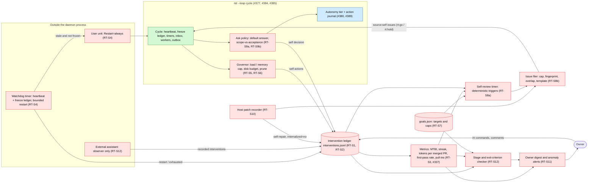

# Self-supervision: roundtable runs unsupervised without the external assistant

Status: design, 2026-11-15. Parent issue: #414 [RT-S]. Nothing in this document is live yet. Production still runs the host loop scripts (`rt-sched.py`, `rt-work.sh`, `bin/rt-*`), which are not in this repository, until the runtime cutover (#391). Where this document says a module "exists", it means a tested library or entry point on `main`. "Wired" means `runtime/rtd.mjs --loop` calls it. It does not mean that anything runs in production.

## Why this layer

The owner measures one thing: **how long roundtable runs unsupervised**, sourcing its own task list and iterating toward its goal. Today the pair "external assistant/supervisor + roundtable" runs unsupervised. Roundtable on its own does not. The external assistant restarts the loop after host freezes, patches the host scripts, lowers the worker cap by hand, answers `rt:ask` questions, merges gate-passed PRs, files batches of issues, writes retrospectives, and sends the owner anomaly reports.

The training data is the inventory of every supervisor intervention so far: 50 rows, 31 host patches and 19 operational interventions, each classified by capability. Code with a named test exists for 21 rows, 5 rows are partial and 24 have nothing. None of it is live. Host self-repair and liveness are mostly ported. Decisions on asks, backlog sourcing, self-review and owner reporting have 0 rows internalized. That missing part is what this layer provides.

This layer finishes the line that the `[RT-S]` tag started: #33 (external supervisor with heartbeat and bounded controls) and its children #249-#253 (heartbeat schema and collector, watchdog rules, ledger and modes, bounded actuator, entrypoint and unit template). Those issues built a supervisor *outside* the loop. This layer moves each of its capabilities *into* the loop, and then reduces the external assistant to a read-only observer. It depends on the [RT-B] daemon work (#374, see [Architecture](architecture.md)) and on the [RT-O] measurement work (#330, in particular #337).

Constraint for the whole design: a Haiku-class model must be able to run it 7x24. Everything on the restart, governor, ledger, metric, trigger, dedupe and cap paths is deterministic code. The model is used only for bounded judgment: it drafts an issue body from a fixed template, and it fills a closed `scopeKind` field on an ask. Every model output is structured and has a default for when it fails to parse.

## The self-supervision loop



## Capability map

Row counts refer to the intervention inventory (31 host patches, 19 operational rows), by kind. "Det." means deterministic code only. "Model-bounded" means a model fills a closed, validated field and a default applies when it fails.

| Cap | What the supervisor did (inventory rows by kind) | In-repo replacement | Det. / model | Status |
| --- | --- | --- | --- | --- |
| L liveness/restart | 10 rows: usage-limit waits (limit, limitmain, budget, nofunds patches), a crash on a cut UTF-8 sequence, the scheduler hang guard (waitguard), 19 live scheduler starts, at least 3 of them after host freezes; a missing `gh` binary that skipped cycles; continuous watching for freezes | #377 `runLoop`, `boundedWait`, freeze ledger, cycle deadline, heartbeat and the report-only `scripts/rtd-watchdog.mjs`; #308 fallback; #388 recovery table (merged, called from the cycle). New: **RT-S4** user unit with restart policy, watchdog that restarts with a bound and is freeze-aware, restart-and-adopt test, missing-tool alert | Det. | #377 and #388 exist and are wired into `--loop`; restart and the user unit are new |
| H self-repair of host code | 13 rows: gate order, commit author, routing presets, reviewer retry, acceptance-scope diff check, skill selection, sync budget, sub-issue retry, series key, the scope-vs-acceptance decider rule | Host patch inventory with its test (#334 / #361); ported rules under `runtime/lib/` with named tests. New: **RT-S10** host patch recorder with an automatic follow-up issue and a required regression test; **RT-S8a** trigger T2 on `internalized=no` | Det. | Inventory exists; 9 of 13 ported; recorder and trigger are new |
| R resource governance | 4 rows: single merge-lock holder; temp and lock leak pruning (tmpclean, a state dir of about 1.2 GB); manual worker cap 8 to 6 at load 15-21; three manual cap reloads | `lock.mjs` (merge lock, anchor lock pruning #354), #377 `effectiveCap` (freeze-driven only), #320 test leaks. New: **RT-S5** load and memory cap with hysteresis; **RT-S6** disk budget, stale lock and temp pruning each cycle | Det. | Freeze cap exists and is wired; load, memory and disk are new |
| D decision on asks | 6 rows: disputed-decision escalation; the scope-vs-acceptance rule; owner-style decisions on #334, #340, #322; 4 dependency rewrites | `decision-cards.mjs`, wired by #387 (merged), but the daemon has no card provider, so every ask, closed or not, suspends its line today; `machine.mjs` closed categories; #380 `autonomyTier` (library, called by nothing yet); #389 action journal (merged, library, called by nothing yet); #390 replies (open). New: **RT-S9a** ask policy library with the scope-vs-acceptance rule and fixtures from the three real cases; **RT-S9b** default answer executed in the daemon | Model-bounded (closed `scopeKind`), deterministic policy | Cards wired; tier and journal library-only; policy is new |
| M merge/unblock | 7 rows: safety record format, blocked-item rule, close-without-PR, record read-back retry, CI wait, cancelled-CI re-run, merging gate-passed PRs by hand | `merge.mjs`, `gates.mjs` (recordretry, ciwait, cirerun ported), #380 tiers and #389 journal (both library-only), #312 ordered merges | Det. | Partial; no new RT-S child. The three unported rows become backlog through RT-S10 and trigger T5 |
| B backlog sourcing | 6 rows: queue trimming, follow-up queuing, triage of 13 issues, research findings pushed into 6 issues, acceptance supplements on 5 issues, the [RT-B] redesign batch | `intake-backlog.mjs`, `intake-triage.mjs` (library), `overlap.mjs` (#342), `intake.mjs` admission. New: **RT-S7** goal file; **RT-S8a** deterministic triggers; **RT-S8b** filer with caps, fingerprint and overlap dedupe | Det. triggers; model-bounded body drafting | Libraries exist; sourcing is new |
| S self-review/retrospective | 3 rows: process analysis into [RT-O] #330 and 10 children; extra acceptance on 6 issues; the research discussion | `reflect.mjs` (library; #386 wires it, open), #337 metrics (open). New: **RT-S8a** reads metrics, the ledger, failures, open issues and case notes on a timer | Det. | Library-only; self-review is new |
| O owner reporting | 1 row: a supervise routine every 2 h, anomaly-only reports, batch summaries of merged PRs | Outbox with GitHub provider (#385, wired; it delivers `comment` and `label` items and rejects `notification` items, so the `stall-alert` and `approval-request` items that #387 and #388 enqueue are not delivered yet), IM adapters (#381, open). New: **RT-S11** daily digest, immediate anomaly alerts and a GitHub delivery path for `notification` items; **RT-S12** stage report | Det. (fixed templates) | Outbox wired; digest and notification delivery are new |

## (a) Intervention ledger and metrics

### Ledger

File: `<workspace>/.roundtable/state/interventions.jsonl`, append-only, one JSON object per line, schema version 1. Code: `runtime/lib/interventions.mjs` and the CLI `scripts/rt-intervention.mjs` (RT-S1).

| Field | Type | Meaning |
| --- | --- | --- |
| `v` | `1` | schema version |
| `id` | string | `iv:` + the first 16 hex characters of `sha256(source, category, ref, key)`; `key` is the cause (comment id, actuator decision id, patch tag, `cli:<time>`). Appending an id that already exists is a no-op, so replaying a producer appends nothing. |
| `at` | ISO 8601 UTC | when the intervention happened |
| `category` | enum | `liveness`, `self-repair`, `resource`, `decision`, `merge`, `backlog`, `self-review`, `reporting` (the L, H, R, D, M, B, S, O capabilities), or `owner-only` (see stage S5) |
| `ref` | string | `#<n>` (issue or PR), `patch:<tag>`, `rt:<command>`, or `none` |
| `reason` | string | one line, at most 300 code points, passed through the hygiene scanner (`hygiene.mjs`); no host names, paths or credentials |
| `internalized` | `yes`, `partial`, `no` | whether a tested in-repo rule now covers this kind of intervention |
| `source` | `owner`, `external`, `self` | who acted: the owner, the external assistant/supervisor, or the loop itself |
| `kind` | optional `pause`, `resume` | marks `/rt pause` and `/rt resume`, for the paused-time term below |
| `followUp` | optional integer | issue filed for this entry |

A later entry with the same `ref` and a different `internalized` value updates the view; the latest entry wins. Nothing is rewritten. The seed rows of the inventory can be imported with `scripts/rt-intervention.mjs import --tsv FILE` (columns `time, category, ref, reason, internalized`; source defaults to `external`).

**Writers.**

| Writer | How | Source |
| --- | --- | --- |
| Owner `/rt` commands | `pause`, `resume`, `requeue` (not `status`) parsed by `parseRtCommand` in the daemon dispatch path (RT-S2) | `owner` |
| Owner comments that pull work back in | an owner-authored comment, classified deterministically (RT-S2): a reply to a pending ask is `decision`; a comment on an `rt:blocked` line is `merge`; a comment that re-opens a terminal line (the host rule "owner comment newer than terminal status") is `self-review`; added acceptance on an open line is `backlog` | `owner` |
| External assistant/supervisor | (1) comments posted as the owner account that start with a configured prefix (today "Owner-delegated", "Owner decision", "Owner: additional acceptance", "Superseded by") are classified as `external`; (2) every `apply` action that the actuator in `runtime/supervisor/actuator.mjs` performs; (3) the CLI | `external` |
| Manual host patches | `scripts/rt-host-patch.mjs record` (RT-S10), which writes `self-repair`, `internalized: no` | `external` or `owner` |
| The loop itself | watchdog restarts, governor cap changes, pruning, default-policy decisions, self-sourced issues | `self` |

`self` entries are not interventions. They are the record of interventions the loop did not need. They feed the digest and prove that recording works.

### Metrics

Window `W`: the rolling 7 days that end at `now` (`goals.json` `metrics.windowDays`). The `status` output also shows totals since the first ledger entry.

- **Counted intervention:** an entry with `source` in {`owner`, `external`} and `category` not `owner-only`. `I(W)` is the number of counted interventions with `at` in `W`.
- **Frozen time `F(W)`:** the union of the `host-freeze` intervals in the #377 freeze ledger (`.roundtable/state/freeze-ledger.jsonl`), clipped to `W`.
- **Paused time `P(W)`:** the union of intervals from an owner `pause` entry to the next `resume` entry (or to `now`), clipped to `W` and taken outside `F(W)`.
- **Unsupervised time `U(W) = |W| - F(W) - P(W)`.**
- **MTBI (mean unsupervised time between interventions)** `= U(W) / I(W)` in hours when `I(W) > 0`. When `I(W) = 0` it is reported as the lower bound `U(W)` with `bound: "lower"`.
- **Current streak** `= U([t_last, now])`, where `t_last` is the `at` of the latest counted intervention, or of the first ledger entry when there is none.
- **Tokens per merged PR** `= sum of input + output tokens over all usage-ledger rows of the issues whose PR merged in W (rounds before W included) / number of PRs merged in W`, with `usageKnown` = the share of those issues that have at least one usage row. With no merged PR the value is `n/a`, not 0.
- **First-pass rate** `= |merged PRs in W whose line had one dispatch, zero fix rounds and zero counted interventions referencing the issue or PR| / |merged PRs in W|`.
- **Owner pull-ins** `= |{counted entries in W with source = owner}|`, broken down by category; `external` is shown separately.
- **Self actions** `= |{entries in W with source = self}|`, by category.

**Split with #337.** #337 keeps the `rt metrics` report and its pure functions over the event, usage and freeze ledgers: pull-backs per day, first-dispatch success rate, wakes per issue, fix rounds, gate-fail verdicts, quota-idle time, frozen and stalled time, concurrency, and tokens per merged PR with `usageKnown`. RT-S3 does not reimplement any of these. It adds the ledger-based metrics (counted interventions, MTBI, streak, pull-ins by source and category, self actions, internalized share) in `runtime/lib/self-metrics.mjs`, and a `selfSupervision` block in `rtd.mjs status` that embeds #337's tokens per merged PR and first-pass rate for the same window `W`. If #337 defines first-pass rate differently, #337's definition wins and this section is updated. Missing sources are `n/a` with a reason, never 0, as #337 requires.

## (b) External liveness that survives host freezes

What exists (#377): `rtd.mjs --loop` writes the heartbeat each cycle, classifies the gap between cycles into the freeze ledger (`host-freeze` when wall time advanced and monotonic time did not, otherwise `scheduler-stall`), and exits with code 77 when a cycle misses its deadline. `scripts/rtd-watchdog.mjs` prints a verdict (`fresh`, `host-freeze`, `stale`) and never acts. `deploy/systemd/rtd.service` is a system-level template with `Restart=always` that nobody installs. The supervisor actuator has `restart-daemon` with exponential backoff and an auto-pause after 3 consecutive failures, but `runtime/supervise.mjs` does not wire `apply`.

What RT-S4 adds:

1. **User-level units** under `deploy/systemd/user/`: `rtd.service` (`Restart=always`, `RestartSec=30`, `StartLimitIntervalSec=3600`, `StartLimitBurst=5`, `KillMode=control-group` so that no harness child outlives the daemon), plus `rtd-watchdog.service` (oneshot) and `rtd-watchdog.timer` (`OnUnitActiveSec=5min`, `Persistent=true`). Templates only, with `<placeholder>` values; installing them and enabling lingering for the user are owner steps.
2. **Heartbeat freshness outside the daemon process.** The watchdog is a separate process started by the timer. It reads only the heartbeat file and the freeze ledger, so a hung daemon cannot hide its own staleness.
3. **Freeze-aware.** It does not restart when (a) `watchdogVerdict` says the staleness is covered by the last `host-freeze` entry, or (b) the watchdog itself has just come out of a freeze. It stores `{ wall, mono }` from its previous run (`process.hrtime.bigint()` is the system monotonic clock, comparable across processes on one boot, together with the boot id). When wall time advanced more than one poll beyond monotonic time, it skips one run so the daemon can write its own freeze entry. Freeze intervals never count as daemon failure or as intervention time.
4. **Bounded restart.** `scripts/rtd-watchdog.mjs --restart` runs one allow-listed command (`systemctl --user restart <unit>`, injected for tests). At most 3 restarts in a rolling hour are recorded in `.roundtable/state/watchdog-restarts.jsonl`. Each restart is a `self` ledger entry with category `liveness`. At the limit it stops restarting, enqueues one alert in the outbox (cause id `notice:stall:watchdog:<window start>`) and writes a `self` entry with reason `restart-exhausted`. It resumes after the next fresh heartbeat.
5. **Restart and adopt.** After an unclean kill, the restarted daemon adopts in-flight lines through the existing stale-lease recovery (`claim.mjs` `createClaimCoordinator`, `state.mjs` `staleness` and `recovery`). Each line resumes from its last checkpoint, with no second claim comment and no second worktree. RT-S4 adds the end-to-end test. Re-attaching to a running harness process is out of scope: the unit kills the process group, so a resumed line never runs next to an orphan.
6. **Missing tools** (the missing `gh` row): with `--require-tools gh,git` the watchdog reports `tool-missing` and alerts once per tool per day. Installing a binary stays an owner action.

## (c) Goal file and self-sourced backlog

### Goal file

`runtime/goals.json`, versioned in git and validated by `runtime/lib/goals.mjs` (RT-S7). The loop never edits it: RT-S7 adds the path to the safety-file pattern in `safety.mjs`, so a change is `approve-first` under #380.

```json
{
  "version": 1,
  "northStar": { "metric": "mtbiHours", "target": 72 },
  "capabilities": { "L": "self", "H": "self", "R": "self", "D": "self", "M": "self", "B": "self", "S": "self", "O": "self" },
  "metrics": { "windowDays": 7, "mtbiHoursMin": 24, "firstPassRateMin": 0.8, "ownerPullInsPerWeekMax": 3 },
  "selfReview": { "cadenceHours": 24, "maxPerDay": 3, "maxOpen": 5, "hostPatchMaxAgeDays": 3, "failureRepeat": { "count": 3, "days": 7 } },
  "reporting": { "digestIssue": null, "digestHourUtc": 15 },
  "exit": { "windowHours": 72, "minMergedPrs": 6, "minSelfSourcedCompleted": 1 }
}
```

Capability levels are `external` (the assistant still does it), `partial`, or `self`. The file holds the targets. The current level of each capability is computed by RT-S12 from the ledger: a capability is at `self` when it had no counted intervention in the last 14 days.

### Self-review job

A recurring due timer `self-review:daily` (`event-timers.mjs`, cadence `selfReview.cadenceHours`) fires an inbox event. Its handler is pure code (RT-S8a, `runtime/lib/self-review.mjs`):

`proposals({ goals, metrics, interventions, failures, inventory, openIssues, closedIssues, cases, now })` returns candidates `{ rule, fingerprint, title, evidence[], acceptanceHint, risk }`. Rules are checked in this order:

| Rule | Trigger | Evidence link |
| --- | --- | --- |
| T1 failure-repeat | the same failure class or stall signature occurs `failureRepeat.count` (3) or more times in `failureRepeat.days` (7), from line failure signatures, stall signals, `scheduler-stall` freeze-ledger entries and outbox dead-letters, and no open issue carries the fingerprint | the issues or PRs where it occurred |
| T2 host-patch-age | a ledger entry with category `self-repair` and `internalized: no` older than `hostPatchMaxAgeDays`, with no open `followUp` issue | the ledger entry id and patch tag |
| T3 intervention-repeat | 2 or more counted interventions in one category within 7 days, and no open `source:self` issue for that category | the ledger entry ids |
| T4 metric-breach | a `goals.metrics` threshold breached in two consecutive windows | both metric values and windows |
| T5 inventory-open | a `not ported:` row in `docs/host-patch-inventory.md` that names no tracking issue | the row tag |
| T6 case-improvement | an item in the improvements section of a case note changed in the last 30 days that cites no `#<n>` | the case file and item number |

`fingerprint = sha256(rule + ":" + key)`, first 12 hex characters, where `key` is the failure class, the patch tag, the category, the metric name, the row tag, or the case item.

### Filer

RT-S8b (`runtime/lib/self-review-filer.mjs`) turns candidates into issues:

1. **Caps.** At most `maxPerDay` (3) issues per UTC day and at most `maxOpen` (5) open `source:self` issues. Extra candidates wait for a later run and are recorded, not dropped. This is the lesson of the 54 auto-filed Gate 2 follow-ups, of which 38 were bulk-closed.
2. **Dedupe.** A candidate is skipped when an open issue, or an issue closed in the last 30 days, carries `<!-- rt:fingerprint <fp> -->`, or when `overlap.mjs` (#342) reports similarity above the threshold against closed issues (14 days) or open issues.
3. **Body.** A Haiku-class model fills a fixed JSON template `{ goal, acceptance: [{ run, expected }], outOfScope, touchSet[], lines, files }`. When the output is invalid, a deterministic body is built from the evidence: the goal restates the trigger, and the acceptance is "a regression test reproducing <evidence> passes; `npm test && npm run check` exits 0". The body must pass `intake.mjs` admission, or the candidate is recorded as refused. Every body links its evidence and carries the fingerprint marker.
4. **Idempotent create.** Search for the fingerprint marker, then create, then search again (the #332 two-phase pattern). Each filing is appended to `.roundtable/state/self-review.jsonl` and as a `self` ledger entry with category `backlog`.
5. **Labels and default.** Every issue gets `source:self` (created when missing), a `type:` label and `priority:p2`. `rt:go` is added when the risk is low: rule T1, T2 or T5, no safety file in the touch set, and at most 200 lines. Otherwise the issue gets `rt:hold` with a default: a once timer promotes it to `rt:go` after 24 h, an `auto-notify` label action under #380, unless the owner closes it or adds `rt:owner` before then.

## (d) Asks decided by default policy, never blocking

Rule: every `rt:ask` gets a default answer from policy. It is executed at once when the action is inside the autonomy scope (#380 `autonomyTier` returns `auto-silent` or `auto-notify`), with an after-the-fact notice and a revert path (the #389 action journal, and #390 `/rt rollback`). Only an out-of-scope ask blocks, and it blocks only its own line through `routeCard` (#387).

RT-S9a, `runtime/lib/ask-policy.mjs`, exports the pure function `resolveAsk({ card, issue })`, which returns `{ outcome: 'resolve', resolution, choice?, rule }` or `{ outcome: 'block', reason }`. The first matching rule wins:

1. `card.category` is `credentials`, `destructive` or `production` → `block` (owner question).
2. `scopeKind` is `acceptance-needs-files` → `resolve` with `expand-touch-set` to the listed paths. Meeting the issue's own acceptance is not a scope change. Safety files in the list still follow the safety-merge rule, because the tier of the later merge is `approve-first`. More than 5 files → `decompose`.
3. `scopeKind` is `criterion-unreliable` (shared host, other processes, global counters, timing) → `resolve` with `isolated-reading`: choose the option that keeps the criterion's intent in an isolated, deterministic form, normally the Chief's recommendation, and write the reading into the PR body.
4. The card has a recommendation (always one of `options`, enforced by `decision-cards.mjs`) → `resolve` with `recommendation`.
5. Otherwise → `block` (`no-default`).

`scopeKind` is a closed field that the Chief fills (`acceptance-needs-files`, `criterion-unreliable`, `scope-change`, `none`). When it is missing or invalid, `inferScopeKind(question)` applies fixed keyword rules: "touch set" together with "acceptance" or "criterion" means `acceptance-needs-files`; "shared host", "other processes", "other worktrees", "global count" or "unreliable" means `criterion-unreliable`. Otherwise it is `none`. The `scope` and `direction` categories therefore stop being owner questions. This matches the Chief prompt, which already says to ask people only for `credentials` and `destructive`. RT-S9a ports the host decider rule into the Chief role prompt (`.agents/skills/roundtable-work/prompts/roles/chief.md`) word for word in meaning: *how to meet an issue's own acceptance is not an owner question; expand the touch set to what the criterion needs; replace an unreliable literal criterion with its reliable equivalent and say so in the PR*. A test asserts the prompt text.

**Fixtures from the three real cases.** The policy must reach the answer that the supervisor gave:

| Case | Ask (summary) | Supervisor answer | Policy result |
| --- | --- | --- | --- |
| #334 | The inventory needs every tag class; the full list exists only in host files the session cannot read. A: the list is posted as a comment (recommended); B: authorise a read-only host pass | A, plus the list | `resolve` via rule 4, `choice: A`. The list itself is data only the host holds. The line waits for that input; the wait is not a decision, and supplying the list is a counted `owner` or `external` entry |
| #340 | The merge check refuses every merge because no writer exists; the writer needs files outside the touch set. Options a, b, c; a recommended | none of a, b or c: keep the strict check and implement the writer inside #340 by expanding the touch set, because the acceptance requires it | `resolve` via rule 2, `expand-touch-set` (keep strict), not one of the listed options |
| #322 | `check:leaks` counts global temp entries, which other worktrees' tests change on a shared host. A: private temp dir, global count informational (recommended) | A, noted as the meaning of the criterion | `resolve` via rule 3, `isolated-reading`, `choice: A` |

RT-S9b wires the policy into the daemon card path from #387. Today `daemon-cards.mjs` builds each card with the options approve and reject, the recommendation reject, and a provider that always throws, so every ask suspends. RT-S9b carries the Chief's options, recommendation and `scopeKind` into the card. Before `routeCard`, the daemon calls `resolveAsk`. A `resolve` becomes a `decision` action through `autonomyTier` and the #389 journal (`executed_pending_confirmation` plus one `action-pending-confirmation` notice; the revert restores the line state and labels), and a `self` ledger entry with category `decision`. A `block`, or a tier of `approve-first`, goes to `routeCard`, which suspends that line only. The other lines keep running.

RT-S13c, `runtime/lib/ask-timeout.mjs`, adds the timeout and the standing-rule record. It runs once per cycle in `rtd.mjs` (`sweepAskTimeouts`, after the inbox step):

- **Timeout.** A suspended line whose ask has waited `askTimeoutMs` (default 24 h = `24*60*60*1000`, a sweep option) runs the recommended option. `dispatchAsk` stamps `pending.at` (the first suspension of that question; a re-dispatch of the same question keeps the clock) and `pending.scopeKind`. The run is a `decision` action through the journal (`act:decision:<issue>:<hash>`, `executed_pending_confirmation`, with a `file-restore` revert of the line), a line decision with `source: 'timeout-default'`, and a `self` ledger entry (category `decision`). `/rt rollback` restores the suspended line. A rolled-back ask is not run again. A line suspended before RT-S13c has no `pending.at` and never times out.
- **Red line, never automatic.** Categories `credentials`, `destructive`, `production`, the category `scope`, and `scopeKind: scope-change`. They stay suspended however old. `direction`, `naming` and the other reversible asks are not red-line.
- **Standing rule: proposal only.** Each owner answer (approve or reject, from the repo owner) increments a counter for its kind, `category: <normalised question>` (digits become `#`, punctuation and case are dropped). The third answer writes `{ kind, answers, status: 'proposed' }` to `.roundtable/state/standing-rules.json`. Nothing reads that file yet: `resolveAsk` and the sweep ignore it, so three answers change no decision. `confirmStandingRule({ root, kind, owner })` is the owner's explicit confirmation record and sets `status: 'confirmed'`. Only a proposal can be confirmed. Consulting confirmed rules is not part of RT-S13c.

RT-S13d, `runtime/lib/ask-ledger.mjs` and `runtime/lib/metrics.mjs`, separates two counters in `rt metrics` under `asks`. The ask ledger (`.roundtable/state/ask-ledger.jsonl`) gets one `{ issue, key, route, at }` line per (route, issue, key), with `route` `supervisor` (policy resolve or timeout default) or `owner` (routed to the owner); the question text is not stored. `supervisorHeld` counts asks with any supervisor record, timed at the earliest one; `ownerInterruptions` counts asks with only owner records. So an ask first routed to the owner and then resolved by the timeout counts once, as supervisor-held. An absent ledger is `n/a`, never 0.

## (e) Resource governor

#377 already lowers the cap by one step for each new freeze once 3 freezes fall in 6 h, and raises it after a freeze-free window. That stays as it is. What is missing:

**RT-S5, load and memory cap** (`runtime/lib/governor.mjs`, config `runtime/defaults/governor.json`). Inputs are injected: `os.loadavg()[0]`, the CPU count, and the available memory ratio (`MemAvailable` when readable, else `os.freemem()`). Each cycle the governor counts how many cycles in a row the host was hot (load per core above `load.high`, default 1.5, or available memory below `memory.minRatio`, default 0.10) or cool (load per core below `load.low`, default 0.8, and memory above `memory.okRatio`, default 0.20). It steps the cap down by 1 after 2 hot cycles and up by 1 after 3 cool cycles, within `[min, max]` (default 1 and the base cap). The cap passed to `runWorkers` is `min(effectiveCap(freeze), governorCap)`. Each change is one `self` ledger entry with category `resource` that records the inputs. This replaces the manual cap changes 8 to 6 and the reloads 3 to 2, 4 to 8 and 8 to 6.

**RT-S6, pruning and disk budget** (`runtime/lib/prune.mjs`), the port of the host temp-cleaning rule. At most once every 10 minutes, at the start of a cycle:

- In the system temp directory, remove entries named `rt-lock-*`, `rt-hard-*`, `rt-recovery-*` or `rt-renewal-*` that are older than 30 minutes, owned by the current user, not symlinks (`lstat`), and that hold no lock file whose pid is alive (`pidAlive` in `lock.mjs`).
- Under the lock anchor root (`anchorRootOf` in `lock.mjs`), remove lock directories older than 120 minutes whose holder pid is dead.
- Never delete outside those two roots. With `--dry-run` it only lists.
- Disk budget: when `.roundtable/state` plus the anchor root exceed `disk.stateMaxBytes` (default 512 MiB) after pruning, or the filesystem has less than `disk.minFreeRatio` (default 0.05) free (`fs.statfs`), the governor sets the cap to 0 for new claims (running lines finish), sends one alert per day, and writes a `self` entry. It never deletes worktrees or state to make room. Deleting data stays an owner action.

#320 remains the root-cause fix (tests stop leaking). RT-S6 is the safety net the host had. The inventory row `tmpclean` moves to the RT-S6 test when it lands.

## (f) Host patch to tested rule

A host patch is sometimes unavoidable before the cutover. It must not stay invisible:

1. `scripts/rt-host-patch.mjs record --tag <tag> --files <names> --summary <text> [--diffstat FILE]` (RT-S10) appends a ledger entry with category `self-repair`, `internalized: no` and source `external` or `owner`. It also files a follow-up issue through the RT-S8b filer. The daily cap does not apply, but the fingerprint dedupe does (`T2:<tag>`). The issue body carries the diff summary (base file names and line counts only, hygiene-scanned) and a required acceptance item: "a regression test named in the inventory row fails without the port and passes with it".
2. `docs/host-patch-inventory.md` keeps one row per tag class. RT-S10 tightens its test: a `not ported:` row must name a tracking issue `#<n>`, or use the #391 form `not needed after cutover: <reason>`. The test prints the number of open rows, so they stay visible in every CI run.
3. When the follow-up merges, an entry with the same `ref` and `internalized: yes` is appended.
4. Self-review rule T2 files a follow-up for any `internalized: no` entry older than `hostPatchMaxAgeDays` that has none. Rule T5 does the same for inventory rows.

Goal: zero unported host patches. RT-S12 reports the count, and stage S2 requires it.

## (g) Staged plan and exit criterion

Each stage is measured from the ledger, the freeze ledger, GitHub and `goals.json` by `runtime/lib/stage.mjs` and `scripts/rt-stage.mjs` (RT-S12). The checker prints the current stage, the streak and each unmet condition.

| Stage | The external assistant still | Entry condition | Exit criterion (measured) |
| --- | --- | --- | --- |
| S0 today | restarts, patches the host, sets the cap, decides asks, merges, sources backlog, reports | none | RT-S1, RT-S2 and RT-S3 merged |
| S1 measured | does everything, but records every intervention through the CLI | the ledger exists; RT-S3 metrics appear in `status` | 7 consecutive days in which every day has at least one ledger entry, and every owner comment classified by RT-S2 has an entry |
| S2 alive | stops restarting and stops changing the cap | #391 cutover done (`rtd` live); RT-S4, RT-S5 and RT-S6 merged and installed | 7 days with zero counted `liveness` and `resource` entries; at least one `host-freeze` entry in that period followed by a fresh heartbeat with no counted entry; zero `self-repair` entries with `internalized: no` |
| S3 deciding | stops answering asks | RT-S9b, #387, #389 and #390 merged | 14 days with zero counted `decision` entries; every `rt:ask` in the period has a `self` decision entry or a `block` with an allowed reason; owner rollbacks of policy decisions are at most 1 |
| S4 sourcing | stops filing batches and writing retrospectives | RT-S8a, RT-S8b, RT-S10 and RT-S11 merged | 14 days with zero counted `backlog` and `self-review` entries; at least 3 `source:self` issues closed by a merged PR; at most 20% of `source:self` issues closed as not planned or duplicate |
| S5 observer | only reads (heartbeat, ledger, GitHub) and records any intervention it would have made; its actuator and write access are removed (`runtime/defaults/observer.json`, RT-S12) | S4 exit met | **final exit criterion** below |

**Final exit criterion.** At check time `T`, let `W = [T - 72 h, T]` (`exit.windowHours`). Every condition must hold:

1. The ledger has zero counted interventions in `W`. A counted intervention has `source` in {`owner`, `external`}, `category` not `owner-only`, and `at` in `W`. Freeze time is part of `W` and is not excluded.
2. At least `exit.minMergedPrs` (6) PRs were merged by the daemon in `W` (GitHub merge events whose merge commit is in the daemon's merge ledger).
3. At least `exit.minSelfSourcedCompleted` (1) issue labelled `source:self` was closed in `W` by a merged PR.
4. No freeze is left unrecovered. The watchdog verdict at `T` is `fresh` or `host-freeze`, `W` has no `self` entry with reason `restart-exhausted`, and every `scheduler-stall` freeze-ledger entry in `W` is followed by a heartbeat cycle.
5. Recording was alive. `W` has at least one `self` entry in every 24 h slice, so "zero interventions" cannot come from a ledger that stopped writing.

`scripts/rt-stage.mjs --exit` exits 0 only when all five hold. It prints each condition with its value.

**What stays with the owner by design.** Security-sensitive host changes are owner actions forever, and the loop never automates them: rebooting the host; proxy, SSH, firewall or network configuration; installing system packages or binaries; creating OS users, tokens or credentials; deleting data (state, worktrees, branches, history); stopping or reconfiguring other services on the host; installing or enabling units; `--live` cutover and rollback. They are recorded with category `owner-only`, which is a closed list in RT-S1. They are excluded from MTBI and from the exit count, and listed separately in the digest. Any other owner action is a counted intervention.

## Weak-model constraints

| Constraint | Mechanism |
| --- | --- |
| No model in the restart or governor path | Watchdog, unit, governor, pruning, ledger, metrics, triggers, caps, dedupe and the stage checker are pure code over files. A model outage cannot stop a restart. |
| Structured output only | The issue body is a fixed JSON template validated by intake admission. The ask `scopeKind` is a closed enum. Free text never drives a transition. |
| Default on parse failure | Invalid body JSON gives the deterministic evidence body. An invalid `scopeKind` gives `inferScopeKind`, then `none`, then the recommendation. No default means a block on that line only. |
| Caps | 3 self-sourced issues a day, 5 open; 3 restarts an hour; one alert per condition per day; governor step of 1 per hysteresis period; prune at most every 10 minutes. |
| Idempotency keys | Ledger `iv:<hash>`; fingerprint marker on issues; outbox cause ids (`notice:stall:watchdog:<t>`, `notice:digest:<date>`); timer firing ids; action ids `act:decision:<issue>:<question hash>`. A replayed cycle repeats nothing. |
| Bounded context | Self-review reads aggregates (counts, fingerprints, metric values), not raw logs; drafts get at most 2000 characters of evidence. |
| Hygiene | Every ledger reason, issue body and digest passes `hygiene.mjs` before it is written. No host names, IPs, home paths or credentials. |

## Risks and open questions

- **Alerts are not delivered today.** The GitHub outbox provider rejects `notification` items, so the stall alerts and approval requests already enqueued by the daemon dead-letter. RT-S11 adds a comment-based delivery path until #381 lands. The watchdog delivers its own alert, because the daemon may be down when it fires.
- **Nothing is live before #391.** Every stage after S1 depends on the cutover. Until then the ledger records interventions on the host loop, while the metrics describe a runtime that is not in production.
- **Self-reporting bias.** The streak counts only what is recorded. Mitigations: owner comments are classified automatically (RT-S2), the external assistant records through the CLI, and exit condition 5 requires a live ledger. The external assistant can still forget the CLI. Open question: should the observer also diff GitHub activity by the owner account against the ledger and report unrecorded items?
- **External versus owner on one account.** The external assistant posts as the owner account. The prefix rule is a heuristic. A separate bot account would make `source` exact, but it is an owner credential step.
- **Wrong default decisions.** The policy may expand a touch set where the owner would have refused. Bounds: safety files still go `approve-first`, more than 5 files decompose, every decision has a revert path, and owner rollbacks are measured in stage S3.
- **Backlog spam and drift.** Self-sourced issues may duplicate or wander from the goal. Bounds: the caps, fingerprint and overlap dedupe, admission, evidence links, the `rt:hold` default for higher-risk work, and the S4 exit limit on not-planned closures.
- **Shared-host load.** Load from other processes lowers the cap without the loop being at fault. Hysteresis and a floor of 1 keep it moving. Open question: should the governor use only the daemon's own process-group memory?
- **Freezes stop the watchdog too.** A timer cannot run during a freeze. Persistent timers and the freeze check after the watchdog's own gap prevent restart storms on resume. They do not detect a hang that starts during the freeze until the next timer run.
- **Open: values of the thresholds.** The values for `exit.minMergedPrs`, `metrics.mtbiHoursMin` and `selfReview.maxOpen` are first guesses. The owner owns `goals.json`.
- **Open: is `owner-only` too wide?** The closed list must not become a way around the count. Additions to it are owner changes to RT-S1.

## Work items

Parent: #414 [RT-S]. Children (numbers are distinct series; `a`/`b` siblings must run in order):

| Child | Scope | Depends on | Extends |
| --- | --- | --- | --- |
| #417 [RT-S1] | Intervention ledger module and CLI | none | — |
| #418 [RT-S2] | Producers: owner `/rt` commands, pull-in comments, external actions | #417 | builds on #384, #252 |
| #419 [RT-S3] | MTBI, streak, pull-ins and self actions in `status` | #417, #337 | extends #337 |
| #420 [RT-S4] | User units, freeze-aware bounded watchdog restart, alert, restart-and-adopt | #417 | builds on #377, #253 |
| #421 [RT-S5] | Governor: load and memory cap with hysteresis | #417 | extends #377 |
| #422 [RT-S6] | Governor: lock and temp pruning, disk budget | #417 | related #320, builds on #354 |
| #423 [RT-S7] | Goal file, schema, safety-file protection | none | — |
| #424 [RT-S8a] | Self-review trigger rules T1-T6 | #417, #423 | — |
| #425 [RT-S8b] | Self-review issue filer: caps, dedupe, template, labels | #424 | builds on #384, #342, #332 |
| #426 [RT-S9a] | Ask policy, scope-vs-acceptance rule, #334 / #340 / #322 fixtures | none | — |
| #427 [RT-S9b] | Ask policy in the daemon, execute by default, block only out of scope | #426, #387, #389 | extends #387, #389 |
| #428 [RT-S10] | Host patch recorder, follow-up issue, inventory rule | #417, #425 | builds on #334 / #361 |
| #429 [RT-S11] | Owner digest, anomaly alerts, notification delivery | #419 | builds on #385 |
| #430 [RT-S12] | Stage and exit-criterion checker, observer mode | #417, #419, #423 | builds on #253 |

Not opened again: #337 (keeps the `rt metrics` report), #320 (test leaks), #309 (recovery probes), #308, #333, #334 / #361, #342, #381, #386, #390, #391.
